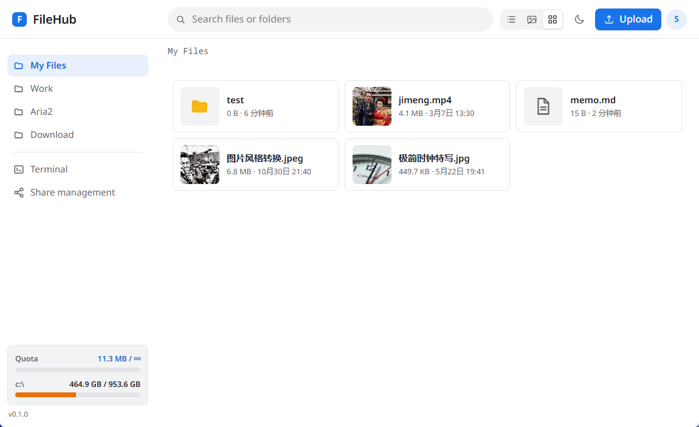

# FileHub

[简体中文](README.zh-CN.md) | English

FileHub is a self-hosted file manager built around a single executable. It gives you a browser-based file browser, resumable uploads, sharing, search, thumbnails, and a small administration console without Docker, Node, or a separate database server at runtime.

The web UI is a Svelte 5 SPA embedded into the Rust binary. Data lives in SQLite (compiled in with `rusqlite`) and the filesystem. A release build is one static Linux binary; Windows builds use the same codebase and produce a separate `filehub.exe`.



## Features

- Browse, upload, download, rename, copy, move, and delete files and directories
- Chunked, resumable uploads and streamed multi-file ZIP downloads
- Directory index with full-text filename search
- Thumbnails for common image formats, with optional `ffmpeg` video frames
- Public file and directory shares with password, expiry, read-only mode, visit counts, and optional uploads for writable directory shares
- Inline text editor with ETag-based optimistic locking and Markdown preview
- Per-user preferences, avatars, quotas, and read-only/writable storage roots
- Admin console for users, external paths, quotas, global feature switches, and audit logs
- Restricted command panel over WebSocket: no shell, only FileHub filesystem commands
- Linux single-binary deployment; Windows LocalSystem service support

## Quick start

### Linux

Requirements: Rust stable, Node.js 22+, pnpm, and a C toolchain for `rusqlite`.

```bash
make setup
make build
sudo install -m 0755 target/x86_64-unknown-linux-musl/release/filehub /usr/local/bin/filehub
```

Create a configuration:

```bash
sudo mkdir -p /etc/filehub /var/lib/filehub /var/cache/filehub /srv/filehub/users
sudo cp config.example.json /etc/filehub/config.json
```

Run in the foreground:

```bash
filehub --config /etc/filehub/config.json
```

Or use systemd:

```ini
[Unit]
Description=FileHub
After=network.target

[Service]
User=filehub
Group=filehub
WorkingDirectory=/var/lib/filehub
ExecStart=/usr/local/bin/filehub --config /etc/filehub/config.json
Restart=on-failure
RestartSec=3

[Install]
WantedBy=multi-user.target
```

The default address is `http://<host>:8080/`. On first start, FileHub prints a setup token to the log (or uses `FILEHUB_SETUP_TOKEN`). Open the UI and use that token to create the first administrator.

### Windows

Cross-compile from Linux:

```bash
cargo install cargo-xwin --locked
make build-windows
```

This produces `target/x86_64-pc-windows-msvc/release/filehub.exe`. Copy it to the Windows machine and, in an elevated PowerShell, install the service:

```powershell
& "C:\Program Files\FileHub\filehub.exe" service install
sc.exe start FileHub
```

The service runs as `LocalSystem`, starts automatically, and stores its database, users, cache, and logs under `C:\ProgramData\FileHub`. Service logs are written to `filehub.log.YYYY-MM-DD` in that directory.

To read the service log and retrieve the first-run setup token:

```powershell
Get-ChildItem C:\ProgramData\FileHub\filehub.log.* |
  Sort-Object LastWriteTime |
  Select-Object -Last 1 |
  Get-Content -Tail 50
```

Stop or uninstall:

```powershell
sc.exe stop FileHub
& "C:\Program Files\FileHub\filehub.exe" service uninstall
```

Windows indexing uses the NTFS MFT fast path when available and falls back to a normal directory scan. USN Journal incremental indexing is planned.

## Configuration

`config.json` supplies deployment defaults; values changed in the admin UI are stored in SQLite and take precedence.

The most important fields are:

```json
{
  "listen": "0.0.0.0:8080",
  "db_path": "/var/lib/filehub/filehub.db",
  "users_root": "/srv/filehub/users",
  "cache_dir": "/var/cache/filehub"
}
```

See [`config.example.json`](config.example.json) for all options. On Windows the defaults are under `C:\ProgramData\FileHub`; an explicit config path can be passed at installation time:

```powershell
& "C:\Program Files\FileHub\filehub.exe" --config "C:\ProgramData\FileHub\config.json" service install
```

Do not expose FileHub directly to the public internet. Put it behind a TLS reverse proxy, enable `security.cookie_secure`, and keep the data directory private.

## API

All application endpoints live under `/api/v1`; `/healthz` is unauthenticated. The OpenAPI contract is in [`docs/openapi.yaml`](docs/openapi.yaml).

## Security notes

- Passwords are hashed with Argon2.
- Session, API, and share tokens are stored as SHA-256 hashes; plaintext tokens are shown only at creation.
- All user filesystem access goes through the path resolver.
- Commands are typed filesystem operations, not shell execution.
- Share links are intentionally bearer secrets. Treat them as credentials.
- Never commit `config.json`, databases, logs, or generated credentials.

## Development

```bash
make check   # Rust fmt/clippy, Svelte lint/typecheck, and tests
make test    # Rust and frontend tests
make build   # Linux musl release
make build-windows
```

Repository layout:

```text
src/          Rust backend and HTTP/WebSocket API
migrations/   Forward-only SQLite migrations
web/          Svelte 5 frontend
docs/         OpenAPI and operations notes
tests/        Rust integration tests
```

## Known limitations

- Non-UTF-8 filenames are not supported and are excluded from indexing/search.
- HEIC/HEIF/RAW thumbnails are not generated.
- Video thumbnails require an optional system `ffmpeg`.
- Windows USN incremental indexing is not implemented yet.
- FileHub is designed for a single application instance per database.

## License

MIT. See [`LICENSE`](LICENSE).
