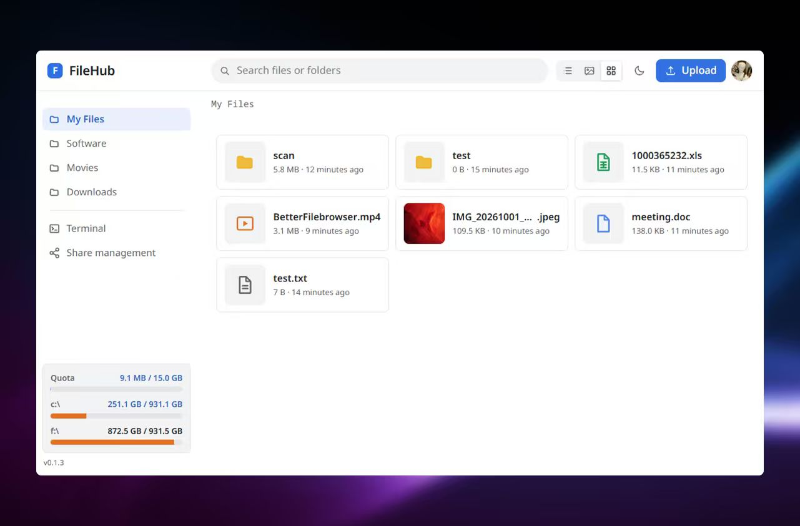

# FileHub

[English](README.md) | 简体中文

FileHub 是一个单可执行文件的自托管文件管理器。它在浏览器里提供文件浏览、断点续传、分享、搜索、缩略图和管理后台，运行时不需要 Docker、Node 或独立数据库服务。

前端是嵌入 Rust 二进制的 Svelte 5 SPA，元数据存放在 SQLite，文件仍然在文件系统里。Linux 发布物是单个静态 musl 二进制；Windows 使用同一套代码，单独产出 `filehub.exe`。



## 功能

- 浏览、上传、下载、重命名、复制、移动和删除文件/目录
- 分片续传上传、多文件流式 ZIP 下载
- 目录索引和文件名全文搜索
- 常见图片缩略图；安装 `ffmpeg` 后可生成视频缩略图
- 文件/目录公开分享：密码、有效期、只读、访问次数；可写目录分享支持上传
- 在线文本编辑器、ETag 乐观锁、Markdown 预览
- 每用户偏好、头像、配额、只读/读写存储根
- 管理后台：用户、外部路径、配额、全局功能开关和审计日志
- WebSocket 受限命令面板：不经过 shell，只执行 FileHub 文件操作
- Linux 单文件部署；Windows 支持 LocalSystem 服务

## 快速开始

### Linux

需要 Rust stable、Node.js 22+、pnpm 和用于 `rusqlite` 的 C 工具链。

```bash
make setup
make build
sudo install -m 0755 target/x86_64-unknown-linux-musl/release/filehub /usr/local/bin/filehub
```

准备配置：

```bash
sudo mkdir -p /etc/filehub /var/lib/filehub /var/cache/filehub /srv/filehub/users
sudo cp config.example.json /etc/filehub/config.json
```

前台运行：

```bash
filehub --config /etc/filehub/config.json
```

systemd 示例：

```ini
[Unit]
Description=FileHub
After=network.target

[Service]
User=filehub
Group=filehub
WorkingDirectory=/var/lib/filehub
ExecStart=/usr/local/bin/filehub --config /etc/filehub/config.json
Restart=on-failure
RestartSec=3

[Install]
WantedBy=multi-user.target
```

默认监听 `http://<host>:8080/`。首次启动会在日志里打印 setup token（也可通过 `FILEHUB_SETUP_TOKEN` 指定），打开页面后用它创建第一个管理员。

### Windows

在 Linux 上交叉编译：

```bash
cargo install cargo-xwin --locked
make build-windows
```

产物是 `target/x86_64-pc-windows-msvc/release/filehub.exe`。复制到 Windows 后，用管理员 PowerShell 安装服务：

```powershell
& "C:\Program Files\FileHub\filehub.exe" service install
sc.exe start FileHub
```

服务以 `LocalSystem` 运行，开机自启；数据库、用户目录、缓存和日志默认在 `C:\ProgramData\FileHub`。日志文件名是 `filehub.log.YYYY-MM-DD`。

读取服务日志和首次初始化 token：

```powershell
Get-ChildItem C:\ProgramData\FileHub\filehub.log.* |
  Sort-Object LastWriteTime |
  Select-Object -Last 1 |
  Get-Content -Tail 50
```

停止和卸载：

```powershell
sc.exe stop FileHub
& "C:\Program Files\FileHub\filehub.exe" service uninstall
```

Windows 索引优先使用 NTFS MFT，之后通过 USN Journal 做增量更新；USN 不可用时回退普通目录扫描。

## 配置

`config.json` 提供部署级默认值；后台修改的设置写入 SQLite，并优先于配置文件。

最重要的字段：

```json
{
  "listen": "0.0.0.0:8080",
  "db_path": "/var/lib/filehub/filehub.db",
  "users_root": "/srv/filehub/users",
  "cache_dir": "/var/cache/filehub"
}
```

完整配置见 [`config.example.json`](config.example.json)。Windows 默认使用 `C:\ProgramData\FileHub`；安装服务时可以显式指定配置：

```powershell
& "C:\Program Files\FileHub\filehub.exe" --config "C:\ProgramData\FileHub\config.json" service install
```

不要把 FileHub 直接暴露到公网。建议放在 TLS 反向代理后面，开启 `security.cookie_secure`，并限制数据目录权限。

## API

所有业务接口前缀为 `/api/v1`，`/healthz` 不需要认证。接口契约见 [`docs/openapi.yaml`](docs/openapi.yaml)。

## 安全说明

- 密码使用 Argon2 哈希
- session、API Token、分享 Token 都只存 SHA-256 哈希；明文只在创建时返回
- 所有用户文件访问都经过路径解析器
- 命令面板是类型化文件操作，不执行 shell
- 分享链接本身就是凭证，请按密码级别保护
- 不要提交 `config.json`、数据库、日志或生成的凭证

## 开发

```bash
make check   # Rust fmt/clippy、Svelte lint/typecheck 和测试
make test    # Rust 与前端测试
make build   # Linux musl release
make build-windows
```

目录：

```text
src/          Rust 后端和 HTTP/WebSocket API
migrations/   只向前迁移的 SQLite schema
web/          Svelte 5 前端
docs/         OpenAPI 与运维文档
tests/        Rust 集成测试
```

## 已知边界

- 不支持非 UTF-8 文件名，也不进入索引/搜索
- 不生成 HEIC/HEIF/RAW 缩略图
- 视频缩略图依赖可选的系统 `ffmpeg`
- Windows USN 增量索引已实现，但上线前应先在目标 NTFS 卷上验证 rename/delete/USN 失效回退场景。
- 每个数据库只支持一个 FileHub 实例

## 许可证

MIT，详见 [`LICENSE`](LICENSE)。
