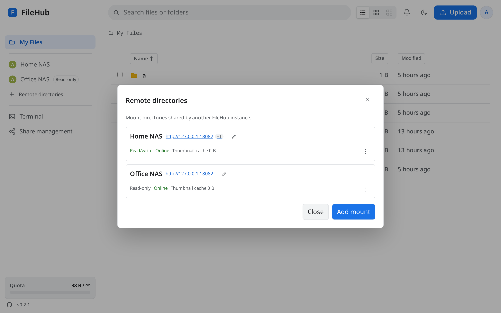
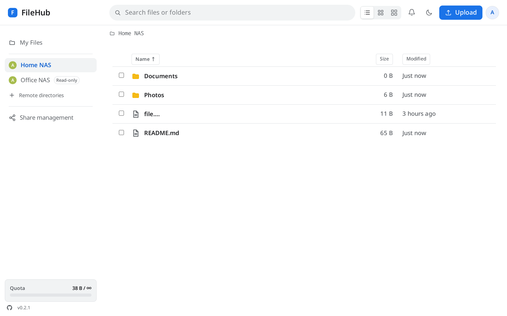

# FileHub 0.2.1

Remote directories are the headline of 0.2.1. FileHub can now mount a folder shared by another FileHub instance as a normal directory in the sidebar. The two instances do not need to be on the same network: one can be a home NAS, one an office server, a VPS, or a laptop. Files stay on the machine that owns them; FileHub only proxies the operations the grant allows.

*Two mounted directories, with read-only/read-write modes, health status, alternate addresses and local thumbnail cache.*

## Why remote directories

- Reach a NAS behind another network without a VPN, SMB or NFS exposure.
- Use one FileHub as the public entry point while mounting folders from private machines.
- Give a family member or teammate a scoped, revocable folder instead of an account.
- Copy or move files between local and remote roots, or between two remote roots.
- Keep thumbnails, directory sizes, metadata and media caches local, so repeated browsing stays fast.

## What you can do

- Browse, download, upload and resume, create, rename, copy, move and delete.
- Search filenames, download a folder as a recursive ZIP, and extract archives in place.
- Preview images and text, choose audio tracks with local transcoding, and preview video.
- Share a folder read-only or read-write.
- Add several addresses to one mount: put the LAN address first and the public address second. FileHub uses the first healthy one, fails over automatically, and switches back when the preferred address recovers. All addresses share the same cache.

## How to enable it

1. Upgrade both FileHub instances to 0.2.1. A 0.2.0 peer still works for basic mounts; 0.2.1 is required to preserve upload modified times.
2. On the mounting side, open **Administration → Settings → Remote access** and enable **Allow remote mounts**.
3. On the sharing side, enable **Allow sharing out** in the same section.
4. Open **Administration → Users** and enable **Allow remote mounts** for the user who will mount, and **Allow sharing out** for the user who will share.
5. On the sharing side, open **Personal settings → Remote sharing**, create a token, add the folders to expose, choose read-only or read-write, and copy the invite.
6. On the mounting side, open the sidebar **Remote directories** entry, paste the invite or enter the address and token, choose a folder, and add alternate addresses if needed.
7. The remote folder appears as a normal root. Sidebar status shows whether it is online, offline, or needs attention.

Grants are scoped and revocable. Federation tokens are hashed on the server and encrypted at rest on the mounting side. A 60-second heartbeat unmounts a mount when its token or grant is revoked. If an address is down, FileHub tries the next one; if all addresses are down, the mount is marked offline and cached browsing remains available.

## Upload modified time

Upload sessions now accept an optional `mtime` (Unix seconds). Local uploads, remote-mount uploads and public-share uploads preserve it, so photos keep their capture time instead of the upload time. Android clients should send MediaStore `DATE_TAKEN` or EXIF time as `mtime`; the web UI sends the browser file's last-modified time automatically.

## Mobile

- Small screens use the tile view with a compact icon top bar.
- The magnifier opens a search dialog instead of squeezing an inline field.
- Remote mount menus are rendered above dialogs, so they are not clipped near the bottom.
- Mobile selection, context menus and safe-area handling are tighter.

Also included: English translations for remote state labels, read/write labels that match the online status color, and several remote mount polish fixes.

Upgrading runs migrations 36 and 37 automatically. Back up the database first if the instance is important.

Full changelog: https://github.com/Llesue/filehub/compare/v0.2.0...v0.2.1

Demo: https://filehub.ihtom.com (demo / filehub2026)

---

# FileHub 0.2.1

远程目录是 0.2.1 的主角。FileHub 现在可以把另一个 FileHub 实例授权的目录挂载成侧栏里的普通目录。两台实例不需要在同一个网络：一台可以是家里的 NAS，一台可以是公司服务器、VPS 或笔记本。文件始终留在拥有它的机器上，FileHub 只代理授权范围内的操作。

*挂载后的远程目录会像普通目录一样出现在侧栏，搜索、上传、复制等操作保持不变。*

## 为什么需要远程目录

- 不用 VPN、不用暴露 SMB/NFS，就能访问另一个网络里的 NAS。
- 用一台公网 FileHub 做入口，挂载内网机器上的目录。
- 给家人或同事一个可撤销的目录授权，而不是一个完整账号。
- 在本机与远程之间、两个远程目录之间复制或移动文件。
- 缩略图、目录大小、元数据和转码缓存都留在本地，反复浏览依然很快。

## 能做什么

- 浏览、下载、上传与续传、新建、重命名、复制、移动、删除。
- 文件名搜索、目录递归 ZIP 下载、就地解压。
- 图片和文本预览、音轨选择与本地转码、视频预览。
- 按只读或读写授权目录。
- 一个挂载可以配置多个地址：内网地址放第一行，公网地址放第二行。FileHub 固定使用第一个可用地址，失败自动切换，内网恢复后自动切回。所有地址共用同一份缓存。

## 怎么启用

1. 两台 FileHub 都升级到 0.2.1。0.2.0 对端仍可完成基础挂载；要保留上传文件的修改时间，需要 0.2.1。
2. 挂载方打开 **系统管理 → 设置 → 远程访问**，勾选 **允许挂载远程目录**。
3. 授权方在同一区域勾选 **允许对外授权目录**。
4. 打开 **系统管理 → 用户**，给要挂载的用户开启 **允许挂载远程**，给要授权的用户开启 **允许对外授权**。
5. 授权方打开 **个人设置 → 远程共享**，新建令牌，添加要暴露的目录，选择只读或读写，复制邀请信息。
6. 挂载方打开侧栏 **远程目录**，粘贴邀请信息或填写地址和令牌，选择目录；需要时添加备用地址。
7. 挂载成功后，它会像普通目录一样出现在侧栏。状态会显示在线、离线或需要处理。

授权按目录生效，可以随时撤销或轮换。联邦令牌在服务端只存哈希，在挂载方加密存储。60 秒心跳发现令牌失效或授权撤销时会自动卸载。某个地址不可用会自动尝试下一个；所有地址都不可用时挂载标记离线，缓存浏览仍然可用。

## 上传保留修改时间

上传会话现在支持可选的 `mtime`（Unix 秒）。本地、远程挂载和公开分享上传都会保留它，照片不会再变成上传时间。Android 客户端应把 MediaStore 的 `DATE_TAKEN` 或 EXIF 拍摄时间作为 `mtime` 传入；网页端会自动使用浏览器的 `lastModified`。

## 手机端

- 小屏只使用平铺视图，顶部栏改为紧凑图标布局。
- 放大镜打开搜索弹窗，不再压缩内联搜索框。
- 远程挂载菜单改为独立浮层，靠近对话框底部也不会被裁切。
- 手机端选中栏、空白菜单和底部安全区一并收紧。

另外还包含：远程状态英文翻译补齐、“读写”和“在线”统一颜色，以及若干远程挂载细节修复。

升级会自动执行 36、37 两个数据库迁移。重要实例请先备份数据库。

完整更新记录：https://github.com/Llesue/filehub/compare/v0.2.0...v0.2.1

Demo：https://filehub.ihtom.com （demo / filehub2026）
